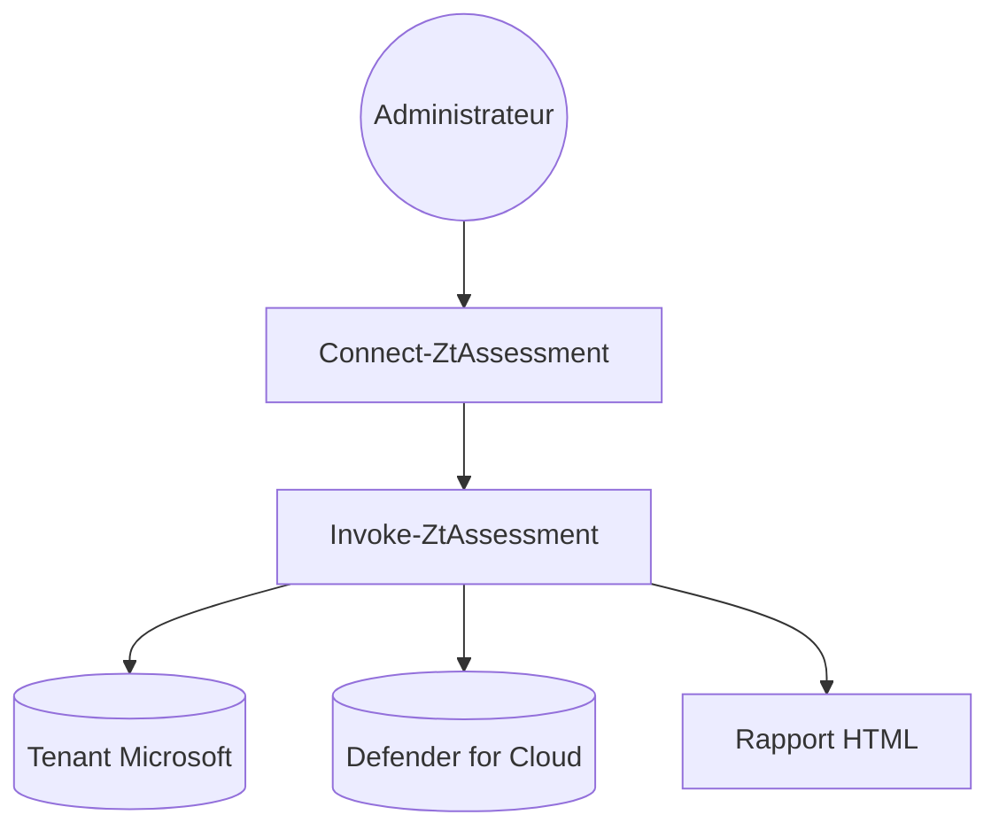

# microsoft/zerotrustassessment

> PowerShell module that audits a Microsoft 365 and Azure tenant read-only and produces an HTML report.

## The problem
Knowing where the security of a Microsoft 365 and Azure tenant stands requires cross-checking many configurations.

## What it actually does
Runs checks across seven pillars (Identity, Devices, Network, Data, Infrastructure, SecOps, AI), applying no fixes, then generates `ZeroTrustAssessmentReport.html`. The Infrastructure pillar relies on Defender for Cloud and on subscriptions tagged `ZeroTrustAssessment:Infrastructure`. A community project by Microsoft employees, with no official support.

## How it is wired


## Trying it
```powershell
Install-PSResource -Name ZeroTrustAssessment -Scope CurrentUser
Connect-ZtAssessment -Tenant contoso.onmicrosoft.com
Invoke-ZtAssessment
```

## Cost and gotchas
PowerShell 7.6+, Windows for full coverage, rights and licences on the tenant. Telemetry is on by default (tenant identifier): use `-DisableTelemetry`. Reports contain sensitive data.

## What it is not
Not a remediation tool nor an official Microsoft product. The diagram mentions a Docusaurus portal and a document API that are not detailed.

## Alternatives
No alternative named in the README.

## For you
Ignore: a security audit of a Microsoft tenant, useful to that tenant's administrator, not to your data / AI work.
