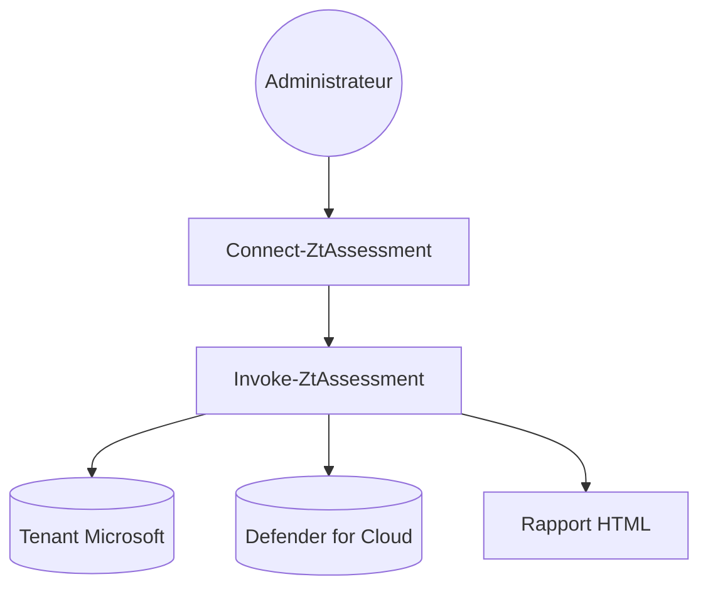

# microsoft/zerotrustassessment

> Module PowerShell qui audite en lecture seule un tenant Microsoft 365 et Azure et produit un rapport HTML.

## Le problème
Savoir où en est la sécurité d'un tenant Microsoft 365 et Azure demande de recouper de nombreuses configurations.

## Ce que ça fait vraiment
Exécute des contrôles sur sept piliers (Identité, Appareils, Réseau, Données, Infrastructure, SecOps, IA), sans appliquer de correctif, puis génère `ZeroTrustAssessmentReport.html`. Le pilier Infrastructure s'appuie sur Defender for Cloud et les abonnements balisés `ZeroTrustAssessment:Infrastructure`. Projet communautaire de salariés Microsoft, sans support officiel.

## Comment c'est branché


## Essayer
```powershell
Install-PSResource -Name ZeroTrustAssessment -Scope CurrentUser
Connect-ZtAssessment -Tenant contoso.onmicrosoft.com
Invoke-ZtAssessment
```

## Coût et pièges
PowerShell 7.6+, Windows pour la couverture complète, droits et licences sur le tenant. Télémétrie active par défaut (identifiant du tenant) : `-DisableTelemetry`. Les rapports contiennent des données sensibles.

## Ce que ce n'est pas
Pas un outil de remédiation ni un produit officiel Microsoft. Le diagramme parle d'un portail Docusaurus et d'une API de documents non détaillés.

## Alternatives
Aucune alternative nommée dans le README.

## Pour toi
Ignorer : audit de sécurité d'un tenant Microsoft, utile à l'administrateur de ce tenant, pas à ton travail data / IA.

