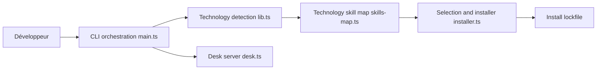

# midudev/autoskills

> CLI that detects a project's stack and installs the matching AI agent skills.

## The problem
Manually choosing and installing the right agent skills for each technology in a project is tedious.

## What it actually does
`npx autoskills` reads `package.json`, Gradle files and config files, selects the relevant skills from a controlled local registry, checks each file by SHA-256 hash against a manifest, then writes `skills-lock.json`. A local web desk (`autoskills ui`) lists the installed skills. The skills are reviewed by AI against prompt injection.

## How it is wired


## Trying it
```bash
npx autoskills
npx autoskills --dry-run
npx autoskills ui
```

## Cost and gotchas
Free, Node 22.6 or later. License not identified. Short README (under 2,000 characters): no detail on which agents are supported.

## What it is not
Not a live source of skills: only a registry verified by the maintainers. The AI security review is a claim that cannot be verified here.

## Alternatives
None named in the README.

## For you
Worth watching: the idea of installing skills according to the stack is good and the hash verification is reassuring, but the license and the coverage outside JS/Gradle are unclear.
