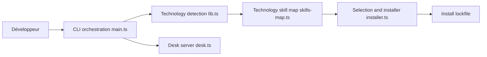

# midudev/autoskills

> CLI qui détecte la pile d'un projet et y installe les skills d'agents IA adaptés.

## Le problème
Choisir et installer à la main les bons skills d'agents pour chaque technologie du projet est fastidieux.

## Ce que ça fait vraiment
`npx autoskills` lit `package.json`, les fichiers Gradle et de config, sélectionne les skills pertinents dans un registre local contrôlé, vérifie chaque fichier par hash SHA-256 d'après un manifeste, puis écrit `skills-lock.json`. Un bureau web local (`autoskills ui`) liste les skills installés. Les skills sont revus par IA contre l'injection de prompt.

## Comment c'est branché


## Essayer
```bash
npx autoskills
npx autoskills --dry-run
npx autoskills ui
```

## Coût et pièges
Gratuit, Node 22.6 ou plus. Licence non identifiée. README court (moins de 2 000 caractères) : pas de détail sur les agents pris en charge.

## Ce que ce n'est pas
Pas une source de skills en direct : seulement un registre vérifié par les mainteneurs. La revue de sécurité par IA est une affirmation non vérifiable ici.

## Alternatives
Aucune nommée dans le README.

## Pour toi
À surveiller : l'idée d'installer des skills selon la pile est bonne et la vérification par hash rassure, mais la licence et la couverture hors JS/Gradle sont floues.

