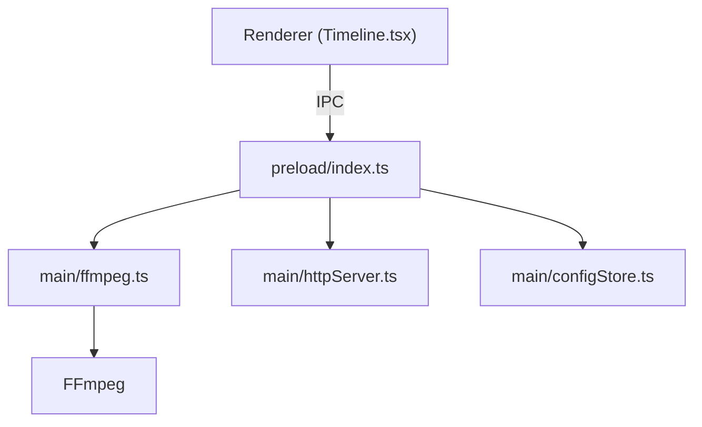

# mifi/lossless-cut

> Multi-platform FFmpeg interface for cutting and remuxing video and audio without re-encoding.

## The problem
Editing a large video file from a camera or drone using a standard video editor requires a slow re-encoding process, which degrades the quality.

## What it actually does
Cuts and merges segments by directly copying streams using FFmpeg, remuxes (from MKV to MP4), adds/removes/extracts tracks, manages chapters, markers, CSV/EDL files, scene detection, silence detection, and black frame detection. Provides a command-line interface (CLI) and an HTTP API.

## How it is wired

## Trying it
No installation required: download the binary (Snap Store, DMG, 7zip Windows, AppImage, or tar.bz2 Linux) from the GitHub releases.

## Cost and gotchas
Available for free manual download; app stores charge a fee to support the author. Only the listed downloads are official. 161 issues remain open.

## What it is not
Not a complete editor: lossy compression is applied to key images. Limited merging is possible only with files using the same codecs.

## Alternatives
No alternative is specified in the README file.

## For you
Recommended for use as a utility: useful for creating demo videos or lossless datasets, GPL-2.0 license – no impact if you don't redistribute it.
