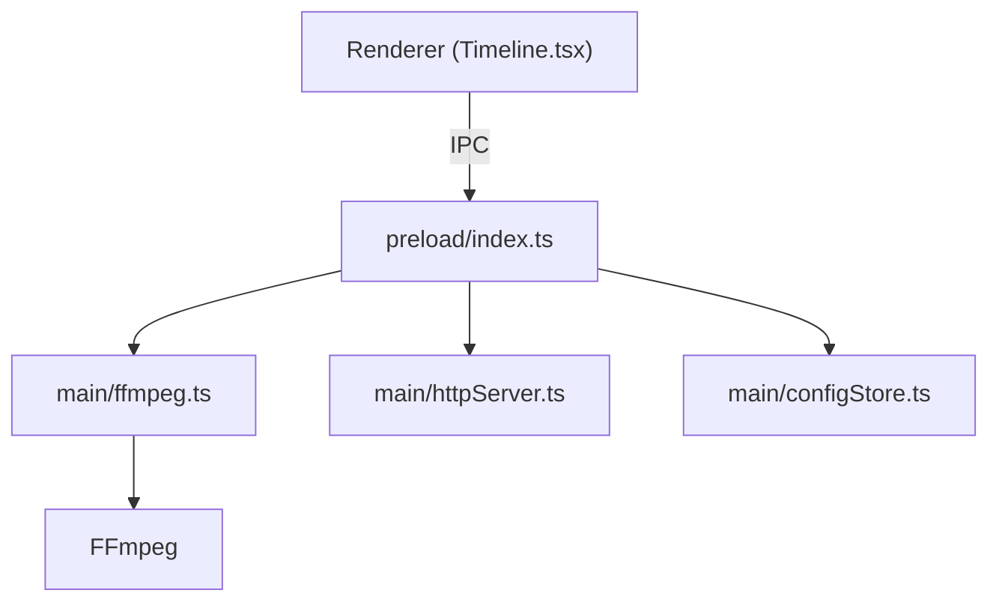

# mifi/lossless-cut

> Interface FFmpeg multiplateforme pour couper et remuxer vidéo et audio sans ré-encodage.

## Le problème
Découper un gros fichier de caméra ou de drone avec un éditeur classique impose un ré-encodage lent qui dégrade la qualité.

## Ce que ça fait vraiment
Coupe et fusionne des segments par copie directe des flux via FFmpeg, remuxe (MKV vers MP4), ajoute/retire/extrait des pistes, gère chapitres, marqueurs, CSV/EDL, détection de scènes, silences et images noires. Expose une CLI et une API HTTP.

## Comment c'est branché

## Essayer
Pas de commande : télécharger le binaire (Snap Store, DMG, 7zip Windows, AppImage ou tar.bz2 Linux) depuis les releases GitHub.

## Coût et pièges
Gratuit en téléchargement manuel ; les magasins d'applications sont payants pour soutenir l'auteur. Seuls les téléchargements listés sont officiels. 161 issues ouvertes.

## Ce que ce n'est pas
Pas un éditeur complet : les coupes lossless tombent sur des images clés. Fusion limitée aux fichiers aux codecs identiques.

## Alternatives
Aucune alternative nommée dans le README.

## Pour toi
À adopter comme utilitaire : utile pour préparer des vidéos de démo ou des jeux de données sans perte, GPL-2.0 sans impact si tu ne le redistribues pas.

