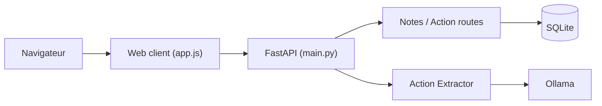

# mihail911/modern-software-dev-assignments

> Assignments from the Stanford CS146S course on the modern developer, for students.

## The problem
Learning modern practices (prompting, RAG, AI tools) with concrete exercises.

## What it actually does
The README only describes installation. From the code: prompting exercises (chained, k-shot, self-consistency, Reflexion, tool calling), a RAG runner with Ollama, and a FastAPI notes-and-actions application on SQLite with a web client.

## How it is wired


## Trying it
```bash
conda create -n cs146s python=3.12 -y
conda activate cs146s
curl -sSL https://install.python-poetry.org | python -
poetry install --no-interaction
```

## Cost and gotchas
Free; Anaconda and Poetry required; a local Ollama model for the RAG part. No license: reuse is legally uncertain.

## What it is not
Not a product nor a library. Short README (under 800 characters): minimal sheet, several weekly copies of the code.

## Alternatives
- No alternative cited in the README.

## For you
Keep an eye on it: useful self-study material on prompting and AI tools, but with no license and no documentation.
