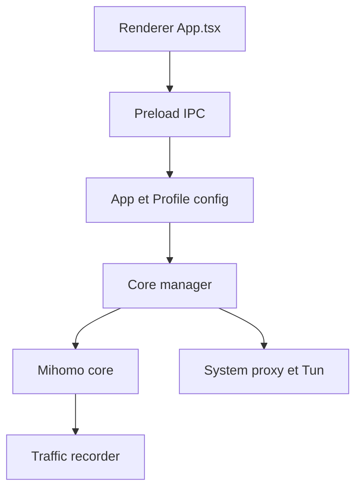

# mihomo-party-org/clash-party

> Electron graphical interface for the Mihomo (Clash Meta) proxy core, for people who manage proxy profiles.

## The problem
Configuring the Mihomo core by hand, with its rules, subscriptions and system settings, is tedious.

## What it actually does
Profile and settings interface that drives the Mihomo core (and a "Smart" core). It handles the system proxy and Tun without service mode, configuration overrides, Sub-Store integration for subscriptions, WebDAV backup, color themes and traffic tracking stored in a local database.

## How it is wired

## Trying it
No command is documented in the README: installation points to the official documentation.

## Cost and gotchas
The software is free, but you need profile sources (a subscription or servers, third-party service). The README promotes a paid provider with a discount code: this is not part of the project. The README is in Chinese.

## What it is not
It is not a proxy or VPN service: no server is provided. It is not a data or AI tool. It documents nothing about the security or privacy of profiles.

## Alternatives
No alternative named in the README.

## For you
Ignore: a desktop proxy client unrelated to your pipelines; useful only if you already manage Mihomo profiles.
