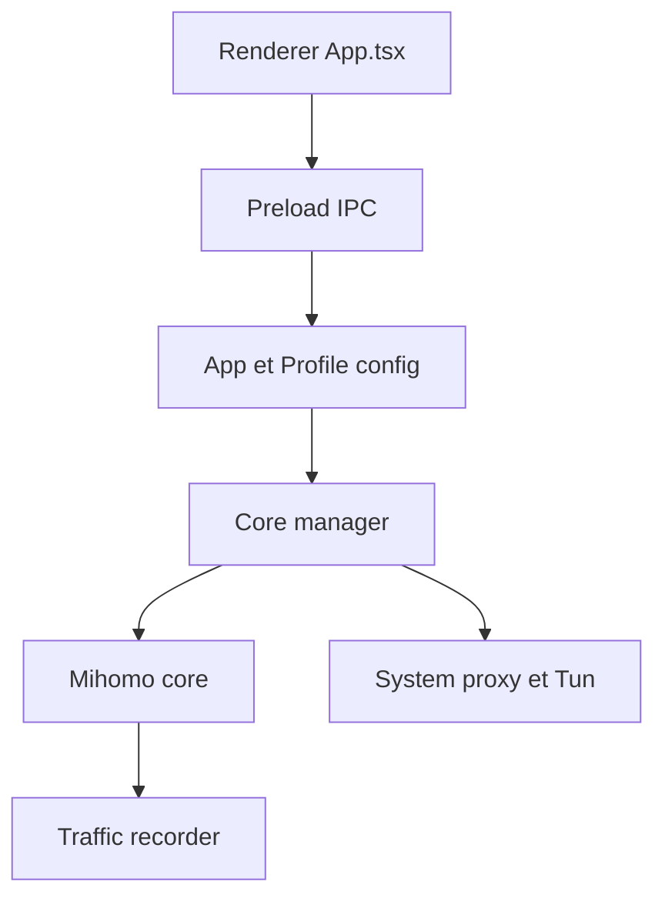

# mihomo-party-org/clash-party

> Interface graphique Electron pour le noyau proxy Mihomo (Clash Meta), pour qui gère ses profils de proxy.

## Le problème
Configurer le noyau Mihomo à la main, avec ses règles, abonnements et réglages système, est fastidieux.

## Ce que ça fait vraiment
Interface de profils et de réglages qui pilote le noyau Mihomo (et un noyau « Smart »). Elle gère le proxy système et Tun sans mode service, des surcharges de configuration, l'intégration Sub-Store pour les abonnements, la sauvegarde par WebDAV, des thèmes de couleurs et un suivi du trafic stocké en base locale.

## Comment c'est branché

## Essayer
Aucune commande documentée dans le README : l'installation renvoie à la documentation officielle.

## Coût et pièges
Le logiciel est gratuit, mais il faut des sources de profils (abonnement ou serveurs, service tiers). Le README fait la promotion d'un fournisseur payant avec code de réduction : ce n'est pas du projet. Le README est en chinois.

## Ce que ce n'est pas
Ce n'est pas un service de proxy ou de VPN : aucun serveur n'est fourni. Ce n'est pas un outil de data ou d'IA. Il ne documente ni sécurité ni confidentialité des profils.

## Alternatives
Aucune alternative nommée dans le README.

## Pour toi
À ignorer : client de proxy de bureau sans rapport avec tes pipelines ; utile seulement si tu gères déjà des profils Mihomo.

