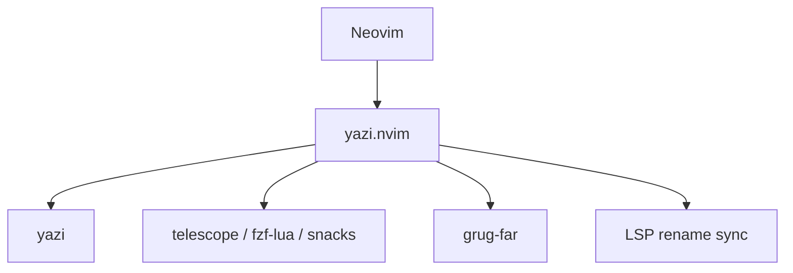

# mikavilpas/yazi.nvim

> Neovim plugin that opens the yazi file manager in a floating window, for Neovim users.

## The problem
Navigating and renaming files in Neovim with netrw is painful, and open buffers get out of sync.

## What it actually does
Opens yazi in a floating window, opens the chosen files as a buffer, split, tab or quickfix. Highlights the hovered file in Neovim. Keeps buffers and LSP servers in sync when renaming, moving or deleting. Integrates with telescope, fzf-lua, snacks.picker and grug-far.

## How it is wired


## Trying it
```lua
{
  "mikavilpas/yazi.nvim",
  version = "*",
  event = "VeryLazy",
  dependencies = { { "nvim-lua/plenary.nvim", lazy = true } },
  keys = { { "<leader>-", mode = { "n", "v" }, "<cmd>Yazi<cr>", desc = "Open yazi at the current file" } },
}
```
Then `:checkhealth yazi` to check versions.

## Cost and gotchas
Free. A recent version of yazi is required; on Windows, Windows 11 at minimum. `realpath` or `grealpath` is needed to copy relative paths.

## What it is not
Not a standalone file manager: it depends on yazi. Does not cover image preview (see the yazi docs).

## Alternatives
No alternative named in the README.

## For you
Worth watching: real comfort if you live in Neovim, but unrelated to data/AI work itself.
