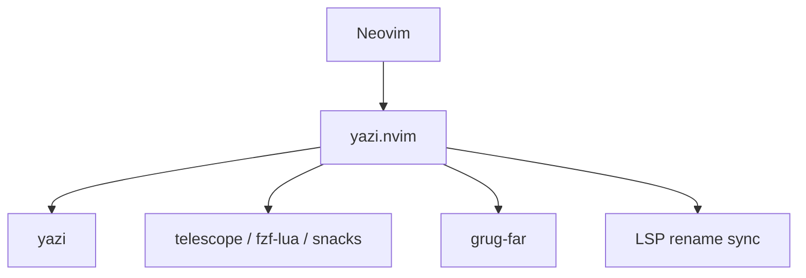

# mikavilpas/yazi.nvim

> Plugin Neovim qui ouvre le gestionnaire de fichiers yazi en fenêtre flottante, pour utilisateurs Neovim.

## Le problème
Naviguer et renommer des fichiers dans Neovim avec netrw est pénible, et les buffers ouverts se désynchronisent.

## Ce que ça fait vraiment
Ouvre yazi dans une fenêtre flottante, ouvre les fichiers choisis en buffer, split, onglet ou quickfix. Surligne dans Neovim le fichier survolé. Garde synchronisés buffers et serveurs LSP quand on renomme, déplace ou supprime. S'intègre à telescope, fzf-lua, snacks.picker et grug-far.

## Comment c'est branché


## Essayer
```lua
{
  "mikavilpas/yazi.nvim",
  version = "*",
  event = "VeryLazy",
  dependencies = { { "nvim-lua/plenary.nvim", lazy = true } },
  keys = { { "<leader>-", mode = { "n", "v" }, "<cmd>Yazi<cr>", desc = "Open yazi at the current file" } },
}
```
Puis `:checkhealth yazi` pour vérifier les versions.

## Coût et pièges
Gratuit. Il faut une version récente de yazi ; sous Windows, Windows 11 minimum. `realpath` ou `grealpath` pour copier les chemins relatifs.

## Ce que ce n'est pas
Pas un gestionnaire de fichiers autonome : il dépend de yazi. Ne couvre pas l'aperçu d'images (voir la doc de yazi).

## Alternatives
Aucune alternative nommée dans le README.

## Pour toi
À surveiller : confort réel si tu vis dans Neovim, mais sans rapport avec le travail data/IA lui-même.

