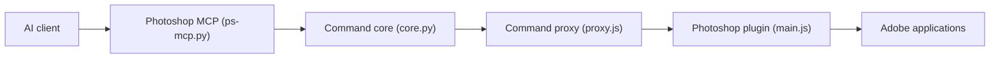

# mikechambers/adb-mcp

> Proof of concept that lets an AI drive Photoshop, Premiere, InDesign, After Effects and Illustrator via MCP.

## The problem
Automating Adobe applications with AI requires a bridge between an MCP client and plugins that cannot listen on a socket.

## What it actually does
One Python MCP server per application exposes tools; a Node proxy relays over WebSocket to UXP plugins (Photoshop, Premiere, InDesign) or CEP plugins (After Effects, Illustrator) that execute the commands. Photoshop is the most complete; After Effects and Illustrator accept arbitrary ExtendScript.

## How it is wired


## Trying it
```bash
uv run mcp install --with fonttools --with python-socketio --with mcp --with requests --with websocket-client --with numpy ps-mcp.py
node proxy.js
```

## Cost and gotchas
Free, but requires Adobe licenses (Photoshop 26+, Premiere Beta) and the UXP Developer tool. The plugin must be reloaded at every restart. Not supported by Adobe.

## What it is not
Not a product: the README calls it a proof of concept. The AI gets text placement wrong and covers only a subset of the features.

## Alternatives
No alternative named in the README (media-utils-mcp is cited as a complement for Premiere).

## For you
Ignore: only for those already in the Adobe creative ecosystem; little value for data/MLOps work.
