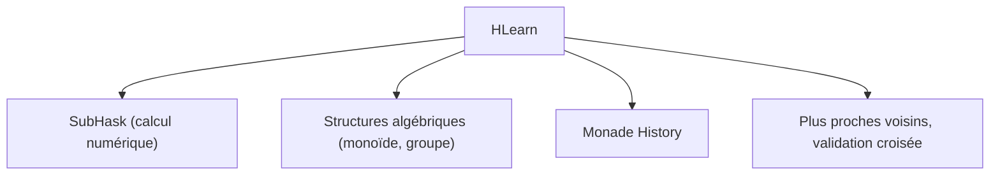

# mikeizbicki/HLearn

> Machine learning library in Haskell, a research project on the ideal learning interface.

## The problem
Learning libraries are either fast but rigid in C/C++, or flexible but slow in Python and R.

## What it actually does
HLearn exploits the algebraic structures of learning: monoids for parallel and online training and fast cross-validation, abelian groups to "untrain" a point, modules for weighting. A `History` monad carries debugging information through optimization without modifying the code. It relies on SubHask for numerical computation. Few popular algorithms are implemented.

## How it is wired
Simplified diagram based on the sheet, no diagram provided.



## Trying it
```bash
# Aucune commande documentée : le README renvoie au dossier examples.
```

## Cost and gotchas
Free, but last push in May 2016: compatibility with recent GHC versions is not guaranteed. Hackage fails to build the haddocks. The cited blog posts are outdated. License to be verified.

## What it is not
Not a competitor to scikit-learn: the algorithm catalog is thin and the documentation sparse. It is mostly a support for publications (ICML, TFP).

## Alternatives
- Julia: the README cites it as a neighboring path, less ambitious according to the author.

## For you
Ignore: interesting for the ideas (monoids, fast cross-validation), but abandoned since 2016 and too thin for production.
