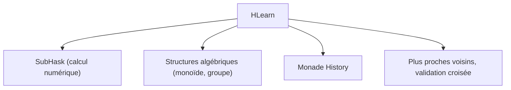

# mikeizbicki/HLearn

> Bibliothèque de machine learning en Haskell, projet de recherche sur l'interface idéale d'apprentissage.

## Le problème
Les bibliothèques d'apprentissage sont rapides mais rigides en C/C++, ou souples mais lentes en Python et R.

## Ce que ça fait vraiment
HLearn exploite les structures algébriques de l'apprentissage : monoïdes pour l'entraînement parallèle, en ligne et la validation croisée rapide, groupes abéliens pour « désentraîner » un point, modules pour pondérer. Une monade `History` fait passer des informations de débogage dans l'optimisation sans modifier le code. Elle s'appuie sur SubHask pour le calcul numérique. Peu d'algorithmes populaires sont implémentés.

## Comment c'est branché
Schéma simplifié d'après la fiche, sans diagramme fourni.



## Essayer
```bash
# Aucune commande documentée : le README renvoie au dossier examples.
```

## Coût et pièges
Gratuit, mais dernier push en mai 2016 : compatibilité avec les GHC récents non garantie. Hackage n'arrive pas à compiler les haddocks. Les billets de blog cités sont périmés. Licence à vérifier.

## Ce que ce n'est pas
Pas un concurrent de scikit-learn : le catalogue d'algorithmes est mince et la documentation clairsemée. C'est surtout un support de publications (ICML, TFP).

## Alternatives
- Julia : le README la cite comme voie voisine, moins ambitieuse selon l'auteur.

## Pour toi
À ignorer : intéressant pour les idées (monoïdes, validation croisée rapide), mais abandonné depuis 2016 et trop mince pour la production.

