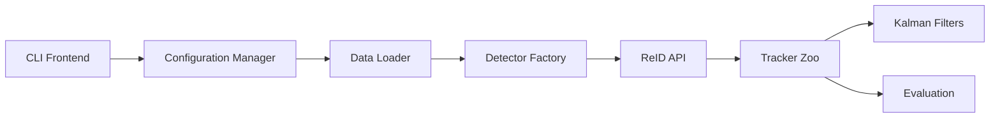

# mikel-brostrom/boxmot

> Multi-object tracking library and CLI with interchangeable trackers and ReID, for vision.

## The problem
Plugging together a detector, a re-identification model and a tracker, then evaluating them on MOT17, requires a lot of ad hoc glue.

## What it actually does
A single `boxmot` CLI for `track`, `eval`, `tune`, `train-reid`, `export`, etc.
About ten trackers (occluboost, botsort, bytetrack, strongsort…) with published HOTA/MOTA/IDF1 scores.
AABB and OBB boxes, Parquet cache of detections and embeddings, optional C++ backend.
A Python API: `tracker.update(dets, frame)`.

## How it is wired


## Trying it
```bash
pip install boxmot
boxmot track --detector yolo26n --reid lmbn_n_duke --tracker occluboost --source 0 --save --show
```

## Cost and gotchas
Free; a GPU is preferable for detection and ReID. The AGPL-3.0 license taints any service that embeds it.

## What it is not
Not a detector: it relies on external detectors (YOLO…). The native C++ is optional, it must be enabled explicitly.

## Alternatives
No alternative named in the README.

## For you
Adopt for any video tracking project: the tracker comparison and built-in evaluation save weeks, provided you accept the AGPL.
