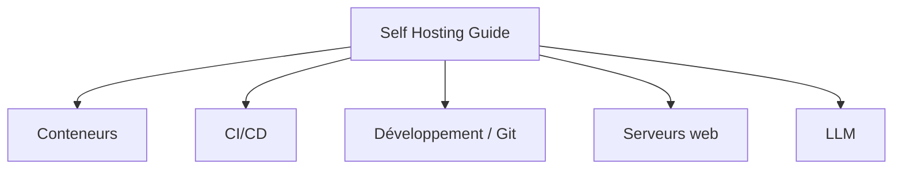

# mikeroyal/Self-Hosting-Guide

> Annotated list of self-hosting tools: containers, CI/CD, Git forges, web servers, local LLMs.

## The problem
Choosing among hundreds of self-hosted tools with no organized starting point.

## What it actually does
A single markdown document organized in sections: containers (Docker, Podman, Portainer, Dozzle, Watchtower), CI/CD (Drone, Woodpecker), development and Git forges (Gitea, GitLab), web servers (Caddy, Nginx, Traefik), local LLMs (llama.cpp, ollama, LocalAI). Launch examples for Chatbot UI and MiniGPT-4 are included. The text provided to the block is truncated before the end.

## How it is wired


## Trying it
```bash
docker build -t chatgpt-ui .
docker run -e OPENAI_API_KEY=xxxxxxxx -p 3000:3000 chatgpt-ui
```

## Cost and gotchas
Free to read; each listed tool has its own costs. The ChatGPT example requires an OpenAI key at your expense; MiniGPT-4 announces about 23 GB of GPU.

## What it is not
Not a step-by-step tutorial nor a tested selection. Last push on 2025-06-27: some entries may be outdated.

## Alternatives
No alternative named in the README.

## For you
Worth watching as a starting directory for self-hosting a platform; with no license and no recent update, check each tool at its source.
