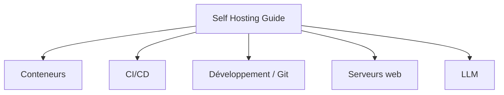

# mikeroyal/Self-Hosting-Guide

> Liste commentée d'outils pour s'auto-héberger : conteneurs, CI/CD, forges Git, serveurs web, LLM locaux.

## Le problème
Choisir parmi des centaines d'outils auto-hébergés sans point de départ organisé.

## Ce que ça fait vraiment
Un unique document markdown organisé en sections : conteneurs (Docker, Podman, Portainer, Dozzle, Watchtower), CI/CD (Drone, Woodpecker), développement et forges Git (Gitea, GitLab), serveurs web (Caddy, Nginx, Traefik), LLM locaux (llama.cpp, ollama, LocalAI). Des exemples de lancement de Chatbot UI et MiniGPT-4 sont inclus. Le texte fourni au bloc est tronqué avant la fin.

## Comment c'est branché


## Essayer
```bash
docker build -t chatgpt-ui .
docker run -e OPENAI_API_KEY=xxxxxxxx -p 3000:3000 chatgpt-ui
```

## Coût et pièges
Gratuit à lire ; chaque outil listé a ses coûts. L'exemple ChatGPT demande une clé OpenAI à ta charge ; MiniGPT-4 annonce environ 23 Go de GPU.

## Ce que ce n'est pas
Pas un tutoriel pas à pas ni une sélection testée. Dernier push en 2025-06-27 : certaines entrées peuvent être périmées.

## Alternatives
Aucune alternative nommée dans le README.

## Pour toi
À surveiller comme annuaire de départ pour auto-héberger une plateforme ; sans licence et sans mise à jour récente, vérifier chaque outil à la source.

