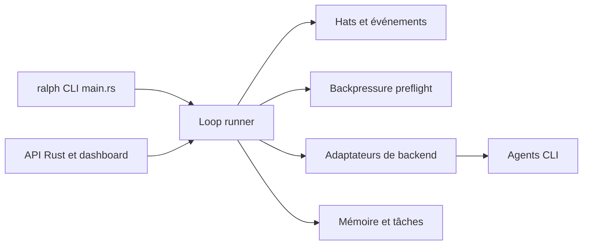

# mikeyobrien/ralph-orchestrator

> CLI orchestrator that reruns a coding agent in a loop until the task is finished.

## The problem
A coding agent often stops before it has finished; you have to rerun it by hand and check tests and lint.

## What it actually does
Applies the "Ralph Wiggum technique": it iterates until it emits `LOOP_COMPLETE` or hits a limit. "Hats" (personas) coordinated by events, guardrails (tests, lint, typecheck) rejecting incomplete work, persistent memories and tasks. Compatible with Claude Code, Codex, Gemini CLI, Kiro, Copilot CLI, OpenCode, etc. Alpha web dashboard, MCP server mode, human questions via Telegram.

## How it is wired


## Trying it
```bash
npm install -g @ralph-orchestrator/ralph-cli
ralph init --backend claude
ralph plan "Add user authentication with JWT"
ralph run -p "Implement the feature in .ralph/specs/user-authentication/"
```

## Cost and gotchas
The cost is that of the underlying agent (key or subscription), multiplied by the number of iterations. The dashboard requires Rust and Node 18+; it is flagged as alpha.

## What it is not
Not an agent: it drives the ones you install. It does not guarantee a correct result, only that it iterates until an exit condition.

## Alternatives
- No alternative named in the README.

## For you
Worth watching: the loop with guardrails is a good pattern to make long tasks reliable, but the token cost and the experimental status call for a bounded trial.
