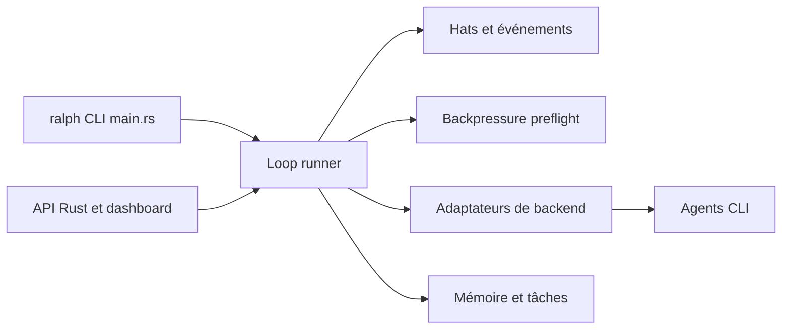

# mikeyobrien/ralph-orchestrator

> Orchestrateur CLI qui relance un agent de code en boucle jusqu'à ce que la tâche soit terminée.

## Le problème
Un agent de code s'arrête souvent avant d'avoir fini ; il faut le relancer à la main et vérifier tests et lint.

## Ce que ça fait vraiment
Applique la « technique Ralph Wiggum » : itère jusqu'à émettre `LOOP_COMPLETE` ou atteindre une limite. Des « chapeaux » (personas) coordonnés par événements, des garde-fous (tests, lint, typecheck) rejetant le travail incomplet, mémoires et tâches persistantes. Compatible avec Claude Code, Codex, Gemini CLI, Kiro, Copilot CLI, OpenCode, etc. Dashboard web alpha, mode serveur MCP, questions humaines via Telegram.

## Comment c'est branché


## Essayer
```bash
npm install -g @ralph-orchestrator/ralph-cli
ralph init --backend claude
ralph plan "Add user authentication with JWT"
ralph run -p "Implement the feature in .ralph/specs/user-authentication/"
```

## Coût et pièges
Le coût est celui de l'agent sous-jacent (clé ou abonnement), multiplié par le nombre d'itérations. Le dashboard exige Rust et Node 18+ ; il est signalé comme alpha.

## Ce que ce n'est pas
Pas un agent : il pilote ceux que tu installes. Il ne garantit pas un résultat correct, seulement qu'il itère jusqu'à une condition de sortie.

## Alternatives
- Aucune alternative nommée dans le README.

## Pour toi
À surveiller : la boucle avec garde-fous est un bon motif pour fiabiliser des tâches longues, mais le coût en tokens et le statut expérimental demandent un essai borné.

