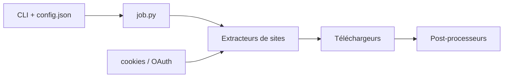

# mikf/gallery-dl

> Command-line program that downloads image galleries and collections from many hosting sites.

## The problem
Bulk-retrieving images or collections from sites that offer no export requires custom scraping for each one.

## What it actually does
You pass URLs; an extractor specific to each site lists the files, a downloader fetches them, then post-processors (metadata, archive, conversion) apply. It handles credentials, cookies (including from the browser) and OAuth. Configuration is in JSON, with flexible file naming. Active development has moved to Codeberg.

## How it is wired


## Trying it
```bash
python -m pip install -U gallery-dl
gallery-dl "https://danbooru.donmai.us/posts?tags=bonocho"
gallery-dl --cookies-from-browser firefox "URL"
```

## Cost and gotchas
Free. The session cookies you export give access to your accounts: handle with care. Complying with the sites' terms remains your responsibility.

## What it is not
It is not a general video tool: for HLS/DASH it relies on yt-dlp or youtube-dl, optional.

## Alternatives
yt-dlp or youtube-dl (cited as optional dependencies) for video.

## For you
Watch: handy for building an image corpus from public sites, but check usage rights and data license before any training.
