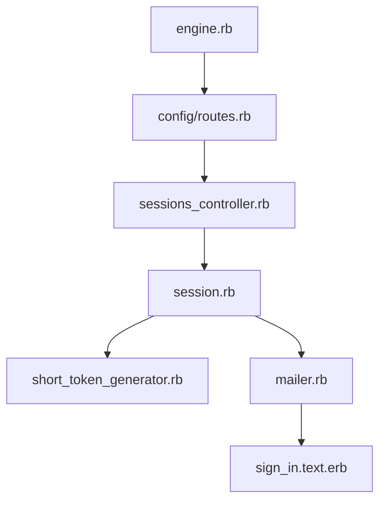

# mikker/passwordless

> Rails engine for passwordless magic-link authentication, for Rails applications.

## The problem
Passwords are poorly chosen and poorly protected; you want email-based login without managing them.

## What it actually does
A Rails engine with a single `Passwordless::Session` model. It generates a short six-character token, sends a link by email, expires the token after ten minutes and the session after one year by default. It provides controller helpers, route constraints, tests and an `after_session_save` callback to send by SMS.

## How it is wired


## Trying it
```sh
bundle add passwordless
bin/rails passwordless_engine:install:migrations
```
```ruby
passwordless_with :email
passwordless_for :users
```

## Cost and gotchas
Free. Ruby and Rails required (not listed in the prerequisites). Your email provider becomes a weak point: the README advises not logging these emails.

## What it is not
Not an identity provider nor OAuth: no user model provided, and no automatic `current_user`.

## Alternatives
- OTP JWT: passwordless JSON Web tokens.

## For you
Ignore: Rails authentication, outside the scope of data, AI or MLOps.
