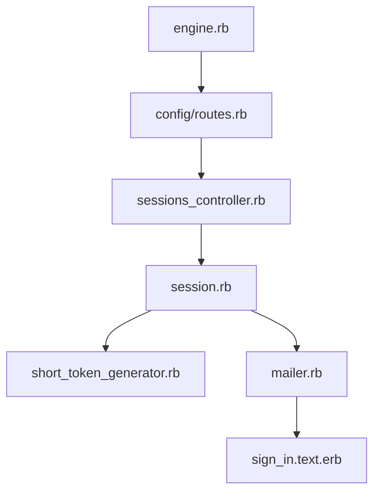

# mikker/passwordless

> Moteur Rails d'authentification par lien magique, sans mot de passe, pour applications Rails.

## Le problème
Les mots de passe sont mal choisis et mal protégés ; on veut une connexion par e-mail sans les gérer.

## Ce que ça fait vraiment
Un moteur Rails avec un seul modèle `Passwordless::Session`. Il génère un jeton court de six caractères, envoie un lien par e-mail, expire le jeton en dix minutes et la session en un an par défaut. Il fournit des assistants de contrôleur, des contraintes de route, des tests et un rappel `after_session_save` pour envoyer par SMS.

## Comment c'est branché


## Essayer
```sh
bundle add passwordless
bin/rails passwordless_engine:install:migrations
```
```ruby
passwordless_with :email
passwordless_for :users
```

## Coût et pièges
Gratuit. Ruby et Rails requis (non listés dans les prérequis). Votre prestataire d'e-mail devient un point faible : le README conseille de ne pas journaliser ces e-mails.

## Ce que ce n'est pas
Pas un fournisseur d'identité ni un OAuth : pas de modèle utilisateur fourni, et pas de `current_user` automatique.

## Alternatives
- OTP JWT : jetons JSON Web sans mot de passe.

## Pour toi
Ignorer : authentification Rails, hors périmètre data, IA ou MLOps.

