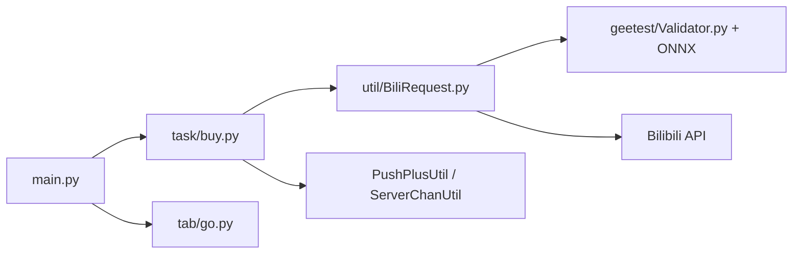

# mikumifa/biliTickerBuy

> Purchase-assistance tool for the Bilibili members' shop, with captcha solving.

## The problem
Getting tickets or limited-sale products on Bilibili requires reacting faster than a human and getting past a Geetest captcha.

## What it actually does
Python application: `main.py` orchestrates tabs (`tab/`) and purchase tasks (`task/buy.py`), calls the Bilibili API through an HTTP client with cookie handling, solves the Geetest captcha with ONNX models, stores state in a local key-value database and sends PushPlus or ServerChan notifications. PyInstaller and Docker packaging.

## How it is wired

## Trying it
The README documents no command: it points to an installation guide and a manual hosted on Feishu. These links are not in the material provided.

## Cost and gotchas
Free, but a Bilibili account and cookies are required. The README imposes the PolyForm Noncommercial 1.0.0 license: no commercial use and no resale service. GitHub did not identify the license.

## What it is not
Not a neutral tool: it bypasses captchas on a third-party platform and the README asks users to respect its rules. The maintainer offers to remove the repository if Bilibili complains.

## Alternatives
- biliTickerSkill: skill version by the same author.
- biliTickerStorm: distributed version by the same author.

## For you
Ignore: captcha-bypass tool under a non-commercial license, outside your data, AI or MLOps profile and legally risky.
