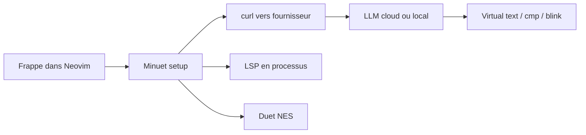

# milanglacier/minuet-ai.nvim

> LLM-based code completion in Neovim, with cloud providers or local models.

## The problem
Getting AI completion in Neovim without a proprietary binary or a dedicated editor.

## What it actually does
Sends the context around the cursor via curl to a provider (OpenAI, Claude, Gemini, Codestral, Ollama, llama.cpp, OpenAI/FIM-compatible services) with chat or FIM prompts. Frontends: virtual text, nvim-cmp, blink-cmp, built-in LSP, mini.completion. Accepts suggestions line by line, streaming, next-edit prediction ("duet", very experimental). Experimental RAG via VectorCode.

## How it is wired


## Trying it
```lua
require('minuet').setup {
    provider = 'codestral',
}
```
```bash
llama-server -hf ggml-org/Qwen2.5-Coder-1.5B-Q8_0-GGUF --port 8012 -ngl 99 -fa -ub 1024 -b 1024 --ctx-size 0 --cache-reuse 256
```

## Cost and gotchas
API key per provider at your expense; every keystroke can trigger a request, hence `throttle` and `debounce` to limit costs and quotas. You must disable the models' thinking mode. Neovim 0.10+ (0.11/0.12 depending on the frontends).

## What it is not
Not a coding agent nor a chat: it is completion. The duet is very experimental.

## Alternatives
No alternative named in the README; VectorCode is cited as a RAG complement.

## For you
Adopt if you code in Neovim: interchangeable providers, local models (Ollama, llama.cpp) possible, no background binary.
