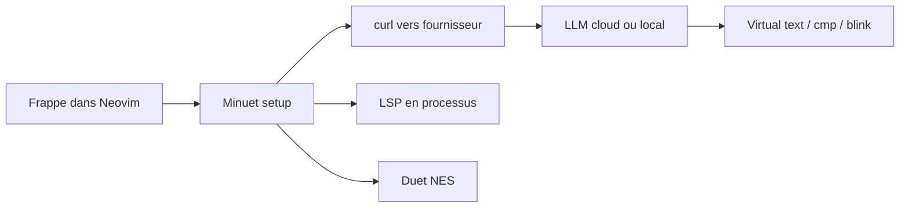

# milanglacier/minuet-ai.nvim

> Complétion de code par LLM dans Neovim, avec fournisseurs cloud ou modèles locaux.

## Le problème
Avoir de la complétion IA dans Neovim sans binaire propriétaire ni éditeur dédié.

## Ce que ça fait vraiment
Envoie le contexte autour du curseur via curl à un fournisseur (OpenAI, Claude, Gemini, Codestral, Ollama, llama.cpp, services compatibles OpenAI/FIM) avec invites de chat ou FIM. Fronts : texte virtuel, nvim-cmp, blink-cmp, LSP intégré, mini.completion. Accepte les suggestions ligne par ligne, streaming, prédiction de prochaine édition (« duet », très expérimentale). RAG expérimental via VectorCode.

## Comment c'est branché


## Essayer
```lua
require('minuet').setup {
    provider = 'codestral',
}
```
```bash
llama-server -hf ggml-org/Qwen2.5-Coder-1.5B-Q8_0-GGUF --port 8012 -ngl 99 -fa -ub 1024 -b 1024 --ctx-size 0 --cache-reuse 256
```

## Coût et pièges
Clé d'API par fournisseur à ta charge ; chaque frappe peut déclencher une requête, d'où `throttle` et `debounce` pour limiter coûts et quotas. Il faut désactiver le mode réflexion des modèles. Neovim 0.10+ (0.11/0.12 selon les fronts).

## Ce que ce n'est pas
Pas un agent de code ni un chat : de la complétion. Le duet est très expérimental.

## Alternatives
Aucune alternative nommée dans le README ; VectorCode est cité comme complément RAG.

## Pour toi
À adopter si tu codes sous Neovim : fournisseurs interchangeables, modèles locaux (Ollama, llama.cpp) possibles, aucun binaire en tâche de fond.

