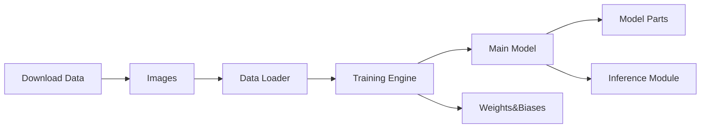

# milesial/Pytorch-UNet

> PyTorch implementation of U-Net for semantic segmentation, trained on the Carvana challenge.

## The problem
You need a simple, readable U-Net baseline to start a segmentation project without a heavy framework.

## What it actually does
U-Net model (`unet/unet_model.py`, `unet_parts.py`), data loader `utils/data_loading.py`, scripts `train.py`, `predict.py`, `evaluate.py`.
Mixed precision `--amp`, scale factor, Weights & Biases tracking.
Pre-trained Carvana model via `torch.hub` (scales 0.5 and 1.0).
Ready-made Docker image; Dice 0.988 claimed on the Carvana test data.

## How it is wired


## Trying it
```bash
pip install -r requirements.txt
bash scripts/download_data.sh
python train.py --amp
python predict.py -i image.jpg -o output.jpg
```

## Cost and gotchas
CUDA GPU recommended, Kaggle account for the data; W&B creates anonymous runs deleted after 7 days.
Last push in 2024: dependencies need to be revalidated.

## What it is not
Not a generic segmentation library: the loader expects `data/imgs` and `data/masks` without subfolders.
GPL-3.0: contaminates a distributed product.

## Alternatives
No alternative named in the README.

## For you
Ignore in production (inactive, GPL); keep as a teaching example to explain U-Net.
