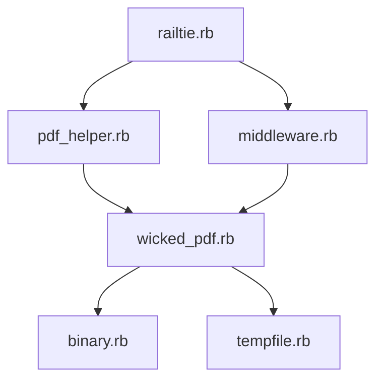

# mileszs/wicked_pdf

> Rails plugin that generates PDFs from HTML views using the wkhtmltopdf tool.

## The problem
Producing PDFs with a dedicated language is cumbersome, whereas we already know how to write HTML.

## What it actually does
- Converts a Rails view into a PDF (`render pdf: "file_name"`).
- Many options: margins, headers, footers, table of contents, pagination.
- Middleware to get a PDF by appending `.pdf` to the URL.
- Generation from a string, a file or a URL.

## How it is wired


## Trying it
```ruby
gem 'wicked_pdf'
gem 'wkhtmltopdf-binary'
```
```bash
rails generate wicked_pdf
```

## Cost and gotchas
Free. The wkhtmltopdf binary is required. Last push on 2025-07-24; the README states support for Ruby 2.2 to 3.2 and Rails 4 to 7.0. Beware of leaking internal addresses (SSRF) if the user supplies the HTML.

## What it is not
Not a standalone PDF engine: everything goes through wkhtmltopdf, with no blocked-host list (only considered). Not a tool for use outside Rails.

## Alternatives
No alternative named in the README (PrinceXML is cited as a paid inspiration).

## For you
Ignore: a little-maintained Rails plugin, far from your data / AI domain.
