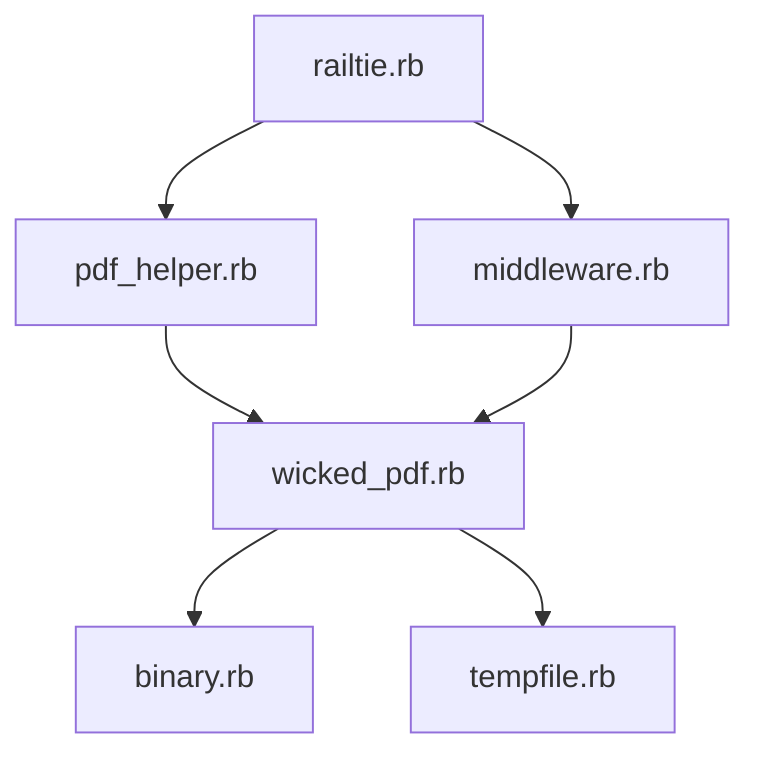

# mileszs/wicked_pdf

> Plugin Rails qui génère des PDF à partir de vues HTML via l'outil wkhtmltopdf.

## Le problème
Produire des PDF avec un langage dédié est lourd, alors qu'on sait déjà écrire du HTML.

## Ce que ça fait vraiment
- Convertit une vue Rails en PDF (`render pdf: "file_name"`).
- Beaucoup d'options : marges, en-têtes, pieds, table des matières, pagination.
- Middleware pour obtenir un PDF en ajoutant `.pdf` à l'URL.
- Génération depuis une chaîne, un fichier ou une URL.

## Comment c'est branché


## Essayer
```ruby
gem 'wicked_pdf'
gem 'wkhtmltopdf-binary'
```
```bash
rails generate wicked_pdf
```

## Coût et pièges
Gratuit. Il faut le binaire wkhtmltopdf. Dernier push le 2025-07-24, README annoncé pour Ruby 2.2 à 3.2 et Rails 4 à 7.0. Attention à la fuite d'adresses internes (SSRF) si l'utilisateur fournit du HTML.

## Ce que ce n'est pas
Pas un moteur PDF autonome : tout passe par wkhtmltopdf, sans liste d'hôtes bloqués (envisagée seulement). Pas un outil hors Rails.

## Alternatives
Aucune alternative nommée dans le README (PrinceXML est cité comme inspiration payante).

## Pour toi
À ignorer : plugin Rails peu actif, loin de ton domaine data / IA.

