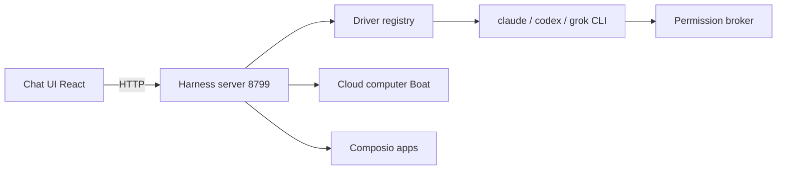

# milind-soni/OpenMausBot

> Chat app where each bot is a local Claude, Codex or Grok agent with its own computer.

## The problem
"Team of bots" agent assistants are closed and tied to one vendor; it is hard to mix models and keep data at home.

## What it actually does
An Electron app (macOS, Windows, Ubuntu beta) with a local harness server on 127.0.0.1:8799 that drives the installed `claude`, `codex`, `grok` CLIs. Each bot has its model, its channels, its apps (Composio) and a cloud (Boat) or local computer. Risky actions go through approval cards. Also provides an MCP server, an `openmausbot` CLI, triggers (scheduling, webhooks) and voices.

## How it is wired


## Trying it
```bash
git clone https://github.com/milind-soni/OpenMausBot && cd OpenMausBot
pnpm install
pnpm dev:server
pnpm dev
npx openmausbot
```

## Cost and gotchas
The agent CLIs' subscriptions remain at your expense; Boat is paid after the trial; Composio and the voices require an account or a key. Node 24+. API keys in plain text in `config.json` in terminal mode. Anonymous analytics are optional and can be disabled.

## What it is not
Not affiliated with xAI, Meta, OpenAI or Manus, and with no crypto token whatsoever. Not mature: beta on Ubuntu, host control disabled under Wayland, voice calls limited to macOS.

## Alternatives
- Grok Bot, Meta Muse, OpenAI dots, Cue by Manus: closed products of which this is the open equivalent.

## For you
Keep an eye on it: handy for personal multi-model local use, but 605 open issues, a single maintainer and cloud dependencies (Boat, Composio) make it a tool to test before depending on it.
