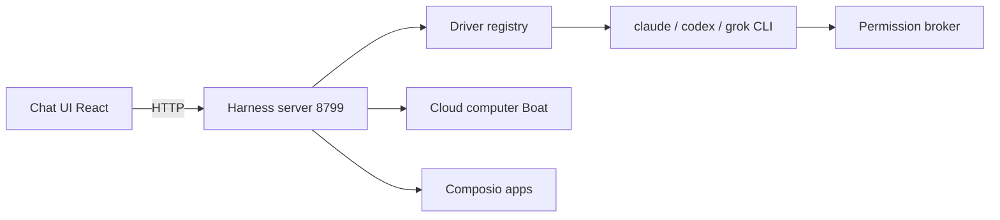

# milind-soni/OpenMausBot

> Application de chat où chaque bot est un agent Claude, Codex ou Grok local avec son ordinateur.

## Le problème
Les assistants-agents « équipe de bots » sont fermés et rattachés à un fournisseur ; difficile de mixer les modèles et de garder les données chez soi.

## Ce que ça fait vraiment
Une appli Electron (macOS, Windows, Ubuntu beta) avec un serveur harness local sur 127.0.0.1:8799 qui pilote les CLI `claude`, `codex`, `grok` installées. Chaque bot a son modèle, ses canaux, ses apps (Composio) et un ordinateur cloud (Boat) ou local. Les actions risquées passent par des cartes d'approbation. Fournit aussi un serveur MCP, une CLI `openmausbot`, des déclencheurs (planification, webhooks) et des voix.

## Comment c'est branché


## Essayer
```bash
git clone https://github.com/milind-soni/OpenMausBot && cd OpenMausBot
pnpm install
pnpm dev:server
pnpm dev
npx openmausbot
```

## Coût et pièges
Les abonnements des CLI d'agents restent à ta charge ; Boat est payant après l'essai ; Composio et les voix demandent un compte ou une clé. Node 24+. Clés API en clair dans `config.json` en mode terminal. Analytics anonymes optionnelles, désactivables.

## Ce que ce n'est pas
Pas affilié à xAI, Meta, OpenAI ni Manus, et sans aucun jeton crypto. Pas mature : bêta sur Ubuntu, contrôle de l'hôte désactivé sous Wayland, appels vocaux limités à macOS.

## Alternatives
- Grok Bot, Meta Muse, OpenAI dots, Cue by Manus : produits fermés dont c'est l'équivalent ouvert.

## Pour toi
À surveiller : pratique pour un usage perso multi-modèles en local, mais 605 issues ouvertes, un seul mainteneur et des dépendances cloud (Boat, Composio) en font un outil à tester avant d'en dépendre.

