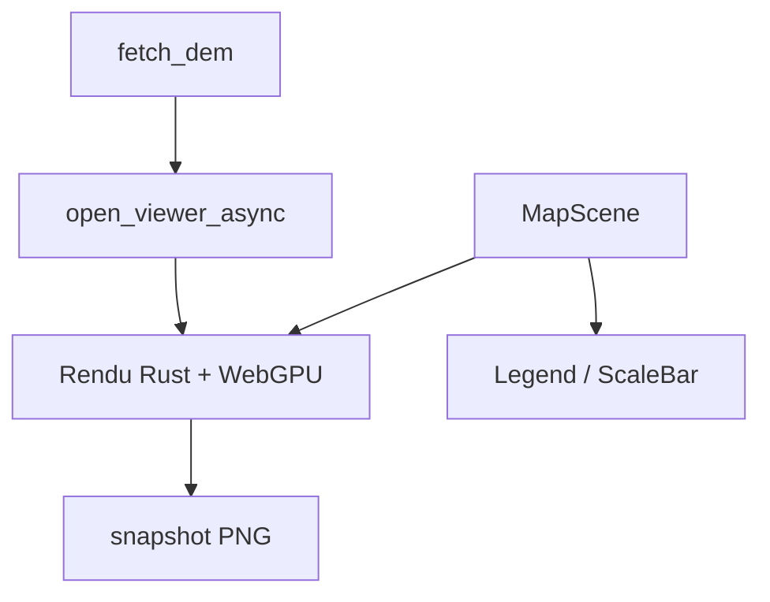

# milos-agathon/forge3d

> Python ray-traced terrain mapping library, with a Rust and WebGPU engine.

## The problem
Producing print-quality 3D maps from elevation data requires heavy, separate GIS or 3D tools.

## What it actually does
Loads DEMs (GeoTIFF, numpy, COG), displays an orbital viewer and exports high-resolution images (up to 7200 by 7200). It styles population or land-cover rasters, adds legends, scale bars, labels, point clouds and 3D Tiles, and animates time-based fields frame by frame.

## How it is wired
Simplified schema based on the sheet, no diagram provided.


## Trying it
```bash
pip install forge3d
pip install "forge3d[jupyter]"
```
```python
import forge3d as f3d
dem_path = f3d.fetch_dem("rainier")
```

## Cost and gotchas
The core is free; `MapPlate`, vector export and building import are Pro features requiring a paid license key. A WebGPU-compatible GPU is required.

## What it is not
Not a full GIS. Not a machine learning library: it is map rendering.

## Alternatives
No alternative named in the README.

## For you
Worth watching if you produce maps or geospatial visualizations in Python: impressive rendering, but key features are in the Pro version.
