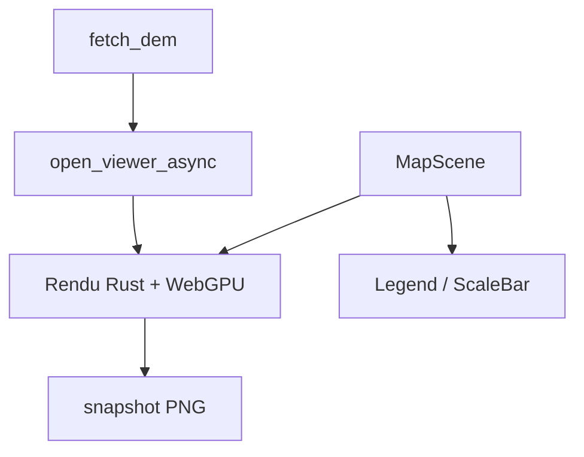

# milos-agathon/forge3d

> Bibliothèque Python de cartographie de terrain en lancer de rayons, moteur Rust et WebGPU.

## Le problème
Produire des cartes 3D de qualité impression à partir de données d'altitude demande de lourds outils SIG ou 3D séparés.

## Ce que ça fait vraiment
Charge des MNT (GeoTIFF, numpy, COG), affiche un visualiseur orbital et exporte des images haute résolution (jusqu'à 7200 par 7200). Elle stylise des rasters de population ou d'occupation du sol, ajoute légendes, échelles, étiquettes, nuages de points et 3D Tiles, et anime des champs temporels image par image.

## Comment c'est branché
Schéma simplifié d'après la fiche, sans diagramme fourni.


## Essayer
```bash
pip install forge3d
pip install "forge3d[jupyter]"
```
```python
import forge3d as f3d
dem_path = f3d.fetch_dem("rainier")
```

## Coût et pièges
Le cœur est gratuit ; `MapPlate`, l'export vectoriel et l'import de bâtiments sont des fonctions Pro avec clé de licence payante. Un GPU compatible WebGPU est nécessaire.

## Ce que ce n'est pas
Pas un SIG complet. Pas une bibliothèque de machine learning : c'est du rendu cartographique.

## Alternatives
Aucune alternative nommée dans le README.

## Pour toi
À surveiller si tu produis des cartes ou visualisations géospatiales en Python : rendu impressionnant, mais fonctions clés en version Pro.

