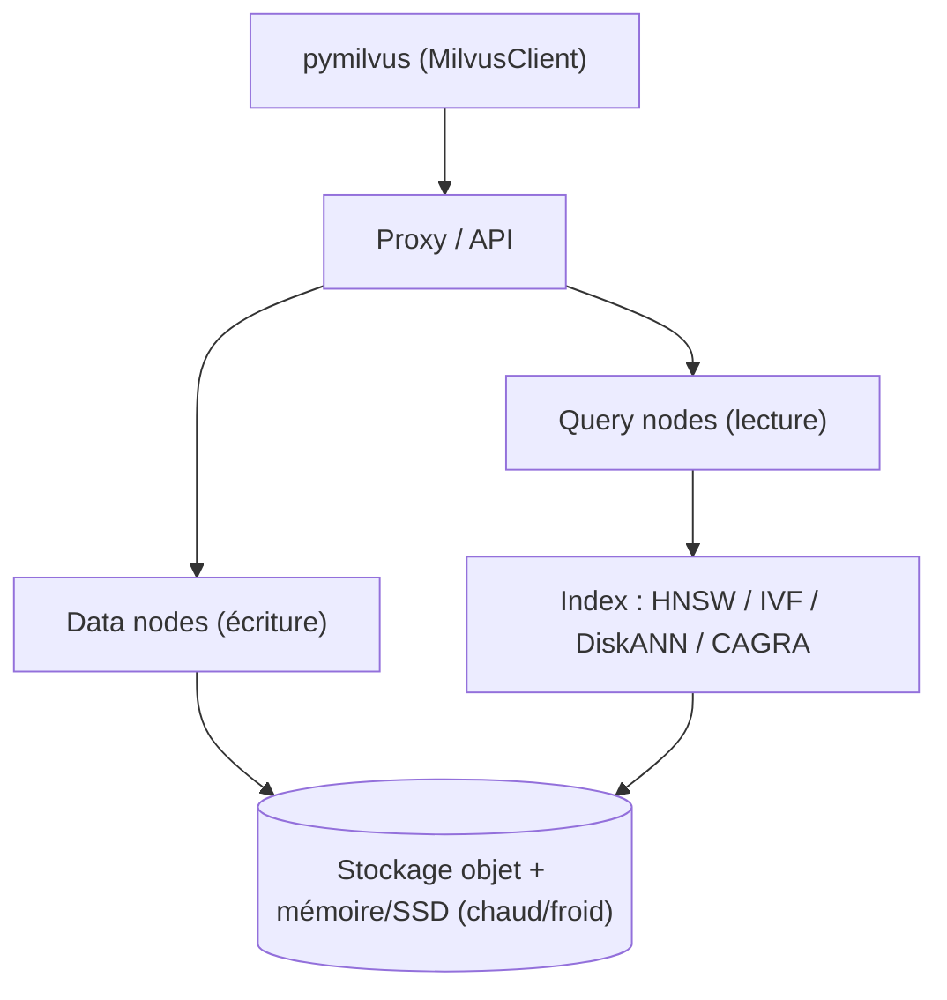

# milvus-io/milvus

> Distributed vector database for semantic search and RAG at large scale.

## The problem
Searching among billions of vectors with metadata filters exceeds what an in-memory index
or a SQL extension can handle without collapsing.

## What it actually does
Stores vectors and scalars (integers, strings, JSON) in the same collection, and does
filtered, range or hybrid search. Separates compute and storage: you add query nodes
for reads and data nodes for writes, on Kubernetes.
Supports HNSW, IVF, FLAT, SCANN, DiskANN, their quantized variants and mmap, plus GPU
indexing (NVIDIA CAGRA). Handles BM25 and learned sparse embeddings (SPLADE, BGE-M3) alongside dense ones,
multi-tenancy by database/collection/partition, and hot/cold storage.

## How it is wired


## Trying it
```bash
pip install -U pymilvus
# Base locale dans un fichier :
#   client = MilvusClient("milvus_demo.db")   # via pymilvus[milvus-lite]
git clone https://github.com/milvus-io/milvus.git
cd milvus/
./scripts/install_deps.sh
make
```

## Cost and gotchas
The software is free (Apache 2.0, LF AI & Data). Zilliz Cloud is the paid managed service of the
main contributor. Building from source requires Go ≥ 1.21, CMake ≥ 3.26.4 (< 4), GCC ≥ 11
and Python ≤ 3.11. Distributed mode assumes Kubernetes; GPU indexing assumes an NVIDIA card.

## What it is not
It is not a relational database: scalars are used to filter, not to do joins.
Milvus Lite (local file) is for a quick start, not for production. Standalone mode
on a single machine exists but does not give the fault tolerance described for the distributed one.

## Alternatives
No competing database is named in the README; it only cites integrations
(LangChain, LlamaIndex, Attu, Milvus CDC).

## For you
The choice when your RAG moves from prototype to volume and metadata filtering matters.
