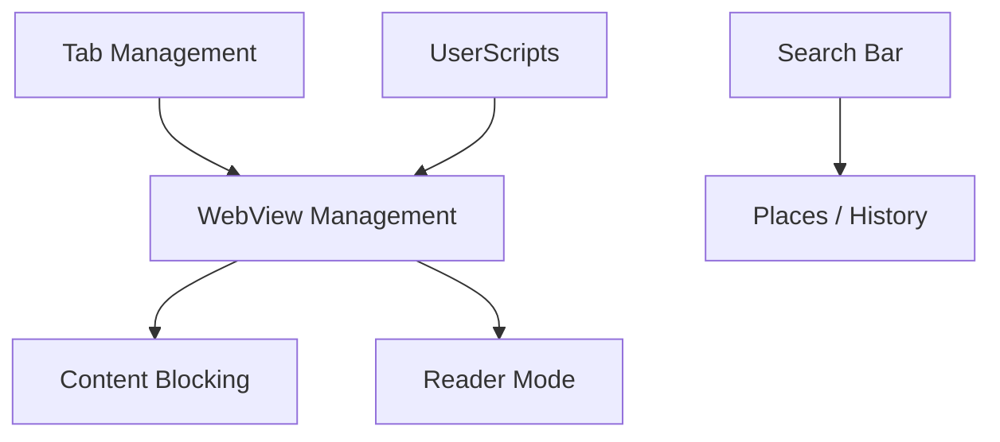

# minbrowser/min

> Minimalist, privacy-focused browser with ad and tracker blocking, for sober everyday use.

## The problem
Mainstream browsers are loaded with options and trackers that distract and track the user.

## What it actually does
An Electron browser with full-text search in history, ad and tracker blocking, automatic reader view, tasks (tab groups), bookmark tags, password manager integration, dark theme, user scripts, HTTPS upgrade and a PDF viewer. Binaries for Windows, macOS and Linux (deb, rpm, AUR).

## How it is wired


## Trying it
```bash
sudo dpkg -i /path/to/download
npm install
npm run start
npm run buildDebian
```

## Cost and gotchas
Free. 605 open issues. Building for macOS requires Xcode, and for Windows Visual Studio.

## What it is not
Not a browser for automation or scraping: it targets daily human use.

## Alternatives
No alternative named in the README.

## For you
Ignore for your work: a plain browser with no data/AI use; only try it if you want a lightweight, private browser.
