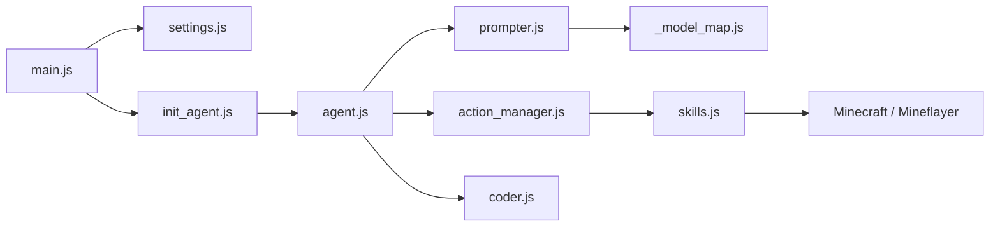

# mindcraft-bots/mindcraft

> LLM-driven Minecraft bots that converse, plan and act via Mineflayer.

## The problem
Studying embodied agents requires a rich environment; Minecraft is one, but connecting it to an LLM remains to be done.

## What it actually does
Each JSON profile defines a bot's models (chat, code, vision, embedding, voice) and prompts.
The bot perceives the world, converses, and chooses Mineflayer commands and skills; optional code generation.
About twenty providers (OpenAI, Anthropic, Ollama, vLLM…).
Task mode for reproducible episodes (gathering, building) and multi-agent evaluation.

## How it is wired


## Trying it
```bash
npm install
node main.js
node main.js --task_path tasks/basic/single_agent.json --task_id gather_oak_logs
docker-compose up --build
```

## Cost and gotchas
Minecraft Java required, API key at your expense. `allow_insecure_coding` makes it execute LLM code: Docker recommended.

## What it is not
Not safe on a public server with code enabled. The maintainers say they respond little to GitHub issues.

## Alternatives
No alternative named in the README.

## For you
Ignore unless you do research on embodied agents: a fun test bench, unrelated to a data or MLOps pipeline.
