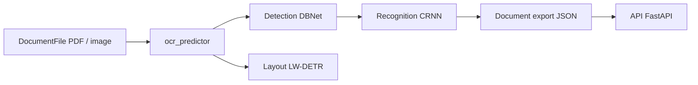

# mindee/doctr

> PyTorch document OCR library: text detection then recognition, layout and KIE.

## The problem
Cleanly extracting text and its structure from PDFs or scanned images requires models and post-processing that are painful to assemble.

## What it actually does
`ocr_predictor` chains a detection model (DBNet, LinkNet, FAST) and a recognition model (CRNN, SAR, MASTER, ViTSTR, PARSeq…).
Reads PDFs, images or web pages; handles rotated pages; `detect_layout` option (titles, tables, headers).
Output as a hierarchical `Document` object exportable to JSON; multi-class KIE predictor.
Streamlit demo, FastAPI API template, GPU Docker images. Now maintained by t2k GmbH.

## How it is wired


## Trying it
```bash
pip install python-doctr
pip install "python-doctr[viz,html,contrib]"
streamlit run demo/app.py
python scripts/analyze.py path/to/your/doc.pdf
docker build -t doctr .
```

## Cost and gotchas
Free, Apache-2.0; Python 3.11+. A GPU is recommended for volume (CUDA 12.2 images).
The generated architecture analysis provides no usable component.

## What it is not
Not a full PDF → Markdown converter with chapters.
Not a language model: no semantic understanding beyond KIE.

## Alternatives
No alternative named in the README.

## For you
Adopt for OCR in your document pipelines: clear Python API, pre-trained models, permissive license.
