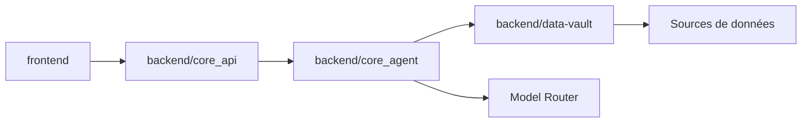

# mindsdb/mindshub

> Open source AI agent workspace for research, analysis and development, with a choice of models.

## The problem
AI assistants lock you into one provider and do not connect easily to company data and tools.

## What it actually does
"Superproject" repository that gathers, via submodules: the front end (Electron/web), `backend/core_api`, `backend/core_agent` and `backend/data-vault`. Described features: a connection vault (BigQuery, Postgres, Gmail…), a model router (Claude, GPT, Gemini, DeepSeek, Qwen…), two agent harnesses (Anton, Hermes), artifacts published as URLs, memory, skills, scheduled tasks.

## How it is wired


## Trying it
```bash
git clone --recurse-submodules https://github.com/mindsdb/minds.git
cd minds
make setup
make dev
```

## Cost and gotchas
Free to start; the Pro version adds frontier models and private artifacts. The model router and the web application rely on the hosted service. `make flush` deletes local conversations and keys.

## What it is not
Not an agent framework to integrate into your code. The repository cloned in the README (`mindsdb/minds`) differs from the name of the cataloged repository (`mindsdb/mindshub`): unexplained discrepancy.

## Alternatives
No alternative named in the README.

## For you
Worth watching: interesting to see an agent stack with a data vault; young and tied to a hosted service, to be tested before entrusting data to it.
