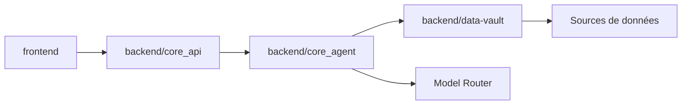

# mindsdb/mindshub

> Espace de travail d'agents IA open source pour la recherche, l'analyse et le développement, avec choix de modèles.

## Le problème
Les assistants IA enferment dans un fournisseur et ne se connectent pas facilement aux données et aux outils de l'entreprise.

## Ce que ça fait vraiment
Dépôt « superprojet » qui réunit par sous-modules : le front (Electron/web), `backend/core_api`, `backend/core_agent` et `backend/data-vault`. Fonctions décrites : coffre de connexions (BigQuery, Postgres, Gmail…), routeur de modèles (Claude, GPT, Gemini, DeepSeek, Qwen…), deux harnais d'agents (Anton, Hermes), artefacts publiés en URL, mémoire, compétences, tâches planifiées.

## Comment c'est branché


## Essayer
```bash
git clone --recurse-submodules https://github.com/mindsdb/minds.git
cd minds
make setup
make dev
```

## Coût et pièges
Gratuit pour démarrer ; la version Pro ajoute les modèles de pointe et les artefacts privés. Le routeur de modèles et l'application web reposent sur le service hébergé. `make flush` supprime conversations et clés locales.

## Ce que ce n'est pas
Pas un framework d'agents à intégrer dans ton code. Le dépôt cloné dans le README (`mindsdb/minds`) diffère du nom du dépôt catalogué (`mindsdb/mindshub`) : écart non expliqué.

## Alternatives
Aucune alternative nommée dans le README.

## Pour toi
Surveiller : intéressant pour voir une pile d'agents avec coffre de données ; jeune et relié à un service hébergé, à tester avant d'y confier des données.

