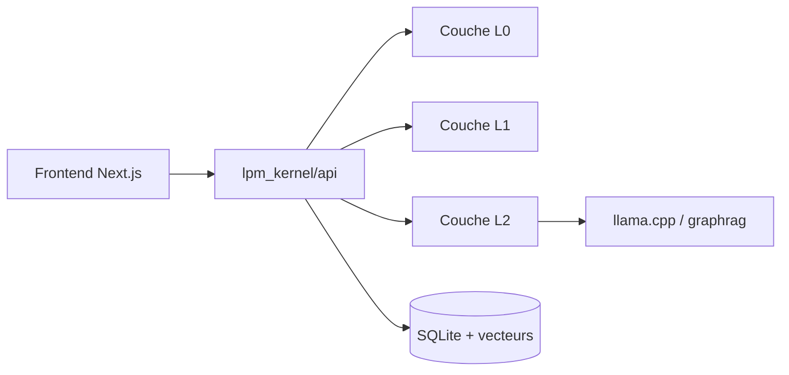

# mindverse/Second-Me

> Open source prototype for locally training an "AI self" from your own memories.

## The problem
Centralized AIs do not know your context and keep your data; the author wants a local personal AI.

## What it actually does
Local training of a model on your memories ("Hierarchical Memory Modeling" and "Me-Alignment" methods, cited with a paper), a web interface, role-play and "AI Space" applications, an optional decentralized network. According to the code: a Next.js frontend, a Python `lpm_kernel` core (layers L0, L1, L2), SQLite and vector databases, graphrag and llama.cpp dependencies, a WeChat bot and MCP modules.

## How it is wired


## Trying it
```bash
git clone https://github.com/mindverse/Second-Me.git
cd Second-Me
make docker-up
```
Then open http://localhost:3000.

## Cost and gotchas
RAM is the limiting factor: 8 GB only allow models of about 0.8 billion parameters (indicative table). Below 0.5B, results are disappointing (the README says so). Last push in September 2025.

## What it is not
Not a guaranteed "100% private" AI: the decentralized network is an option, and the README announces clouds to explore. A May 2025 roadmap with no documented follow-up.

## Alternatives
No alternative named in the README.

## For you
Worth watching: interesting to see a local personal fine-tuning pipeline, but the required hardware quickly limits quality.
