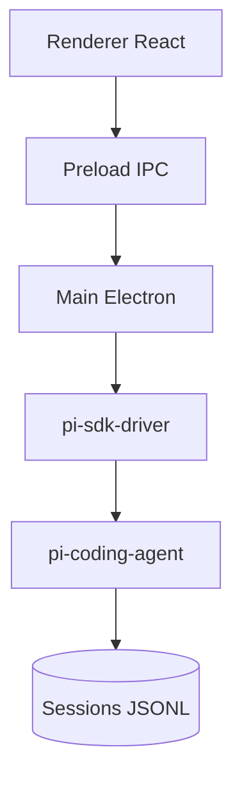

# minghinmatthewlam/pi-gui

> Electron desktop application around the pi coding agent, with parallel threads and change review.

## The problem
Driving the pi agent in a terminal makes it hard to keep track of several tasks and to review changes.

## What it actually does
One thread per task, in your repository or a git worktree. Review tab (uncommitted diff, branch, turn), real terminal, file explorer, scheduled tasks, skills and extensions. It reads and writes pi's session files: what you configure in the CLI carries over.

## How it is wired
Simplified diagram based on the fiche, no diagram provided.


## Trying it
```bash
brew tap minghinmatthewlam/tap
brew trust minghinmatthewlam/tap
brew install --cask pi-gui
```
Otherwise: `.dmg`, `.AppImage`, `.deb` or `.exe` from the releases. In development: `corepack enable`, `pnpm install`, `pnpm dev`.

## Cost and gotchas
You must connect a model provider (OAuth, API key or custom endpoint), so costs are at your expense. Windows builds are not signed.

## What it is not
Not an agent: a shell around pi. Computer use is not built in.

## Alternatives
- computer-use-mcp: separate MCP server for desktop and browser control.

## For you
Worth watching: only if you already use the pi agent, since the interface brings nothing without it.
