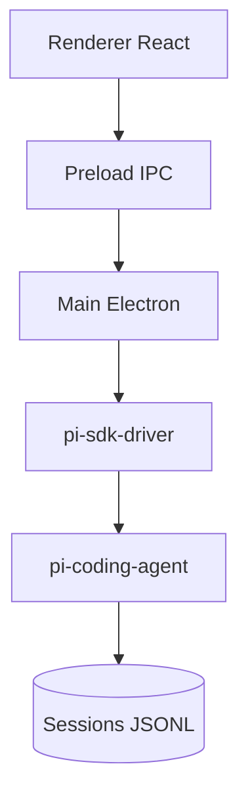

# minghinmatthewlam/pi-gui

> Application de bureau Electron autour de l'agent de code pi, avec threads parallèles et revue des changements.

## Le problème
Piloter l'agent pi en terminal rend difficile le suivi de plusieurs tâches et la relecture des changements.

## Ce que ça fait vraiment
Un thread par tâche, dans ton dépôt ou un worktree git. Onglet Review (diff non commité, branche, tour), terminal réel, explorateur de fichiers, tâches planifiées, skills et extensions. Il lit et écrit les fichiers de session de pi : ce que tu configures dans la CLI se retrouve.

## Comment c'est branché
Schéma simplifié d'après la fiche, sans diagramme fourni.


## Essayer
```bash
brew tap minghinmatthewlam/tap
brew trust minghinmatthewlam/tap
brew install --cask pi-gui
```
Sinon : `.dmg`, `.AppImage`, `.deb` ou `.exe` depuis les releases. En développement : `corepack enable`, `pnpm install`, `pnpm dev`.

## Coût et pièges
Il faut connecter un fournisseur de modèle (OAuth, clé d'API ou point d'accès personnalisé), donc des frais à ta charge. Les builds Windows ne sont pas signés.

## Ce que ce n'est pas
Pas un agent : une coquille autour de pi. L'usage de l'ordinateur n'est pas intégré.

## Alternatives
- computer-use-mcp : serveur MCP séparé pour le contrôle du bureau et du navigateur.

## Pour toi
À surveiller : seulement si tu utilises déjà l'agent pi, car l'interface n'apporte rien sans lui.

