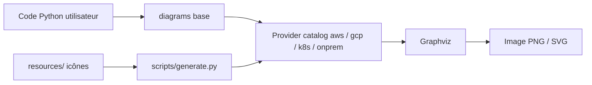

# mingrammer/diagrams

> Python library that draws cloud architectures from code, for architects and MLOps teams.

## The problem
Architecture diagrams made in a graphical tool drift away from the real system and are hard to version.

## What it actually does
You describe nodes and links in Python; the library produces a graph rendered by Graphviz. Per-provider namespaces (AWS, Azure, GCP, Kubernetes, Oracle, Alibaba, on-premise, SaaS, programming…) supply the icons. It drives no cloud resource and generates neither CloudFormation nor Terraform. An online editor (playground) runs in the browser via Pyodide.

## How it is wired


## Trying it
```bash
brew install graphviz
pip install diagrams
```

## Cost and gotchas
Free; Python 3.9+ and Graphviz installed separately. No key or account. The owner is an individual: a single maintainer is likely, though the README does not state it.

## What it is not
Neither an infrastructure discovery tool nor an infra code generator: it draws what you describe.

## Alternatives
- go-diagrams: the Go version.

## For you
Adopt it to document MLOps architectures as code versioned in Git, at zero cost.
