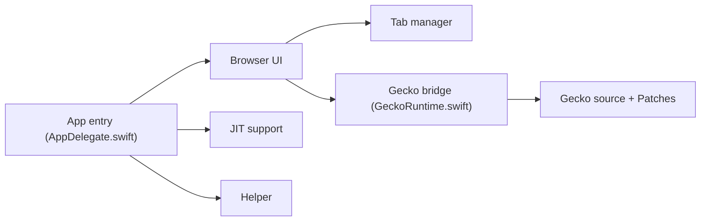

# minh-ton/reynard-browser

> iOS browser based on Gecko rather than WebKit, for old iPhones and the curious.

## The problem
On iOS, all browsers use WebKit, which is tied to the OS: iPhones that are not updated keep an outdated engine.

## What it actually does
Ports the Gecko engine to UIKit through patches (graphics, IPC, widget, JIT), with a GeckoView wrapper for the interface. Supports Firefox extensions and privacy protections. Distributed by sideloading (AltStore/SideStore, TrollStore, jailbreak). The README itself states an experimental status, expect bugs.

## How it is wired


## Trying it
```bash
git clone --recursive https://github.com/minh-ton/reynard-browser
cd reynard-browser
./tools/development/update-gecko.sh
./tools/development/apply-patches.sh
./tools/development/build-idevice.sh
./tools/development/build-gecko.sh
```
Then open `Reynard.xcodeproj` in Xcode.

## Cost and gotchas
Free; building requires Xcode, Python 3, Rust and a large Gecko import; the author provides no build support. LiveContainer is not supported.

## What it is not
Not a browser from the Apple store. Not meant for data work.

## Alternatives
No alternative named in the README (Safari and WebKit serve as a comparison).

## For you
Ignore: iOS curiosity with no use for a data/AI/MLOps profile.
