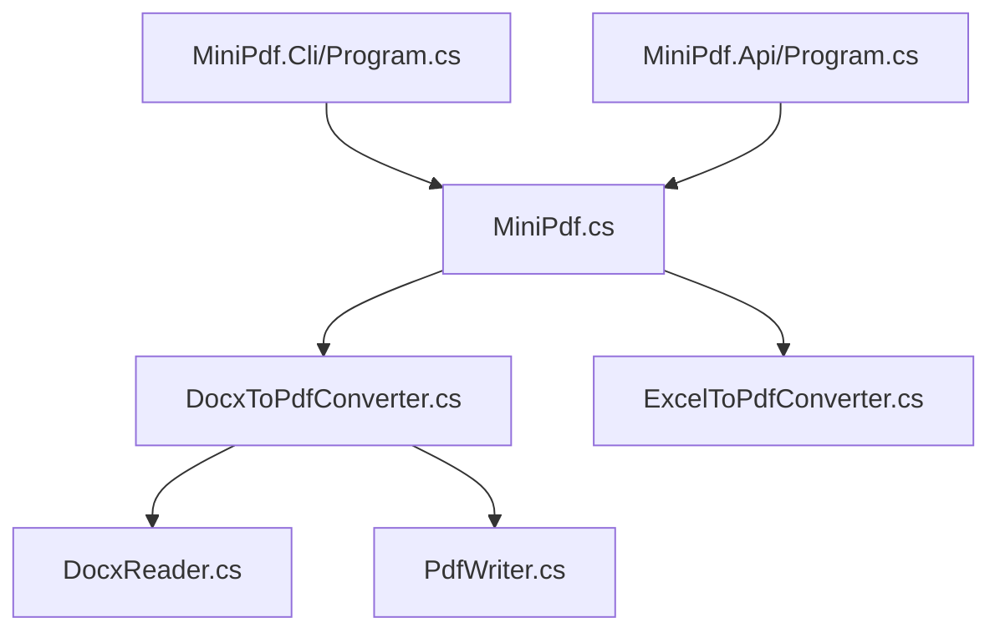

# mini-software/MiniPdf

> Converts Office files (DOCX, XLSX, PPTX) to PDF without Office or LibreOffice, in six languages.

## The problem
Generating a PDF from an Office document often forces you to embed LibreOffice or Microsoft Office on the server.

## What it actually does
`MiniPdf.cs` picks a converter according to the format (DOCX, Excel, PPTX), reads the document with its reader, then writes the PDF with `PdfWriter`. It can be used as a library or on the command line; maturity varies: .NET, Rust and Node are said to be stable, Java and Go experimental.

## How it is wired


## Trying it
```bash
pip install minipdf   # non documenté : le README montre seulement l'import Python
dotnet tool install --global MiniPdf.Cli
minipdf report.docx -o report.pdf
```

## Cost and gotchas
Free. The README claims Apache 2.0 but GitHub does not identify it: to be verified. Rendering of complex layouts may differ from Office. The Python package only covers DOCX.

## What it is not
Not full Office compatibility: the README aims for a practical conversion, not an identical-fidelity one.

## Alternatives
No alternative named in the README.

## For you
Watch: handy for producing PDF reports in a pipeline without LibreOffice, but young (February 2026) and with rendering to be tested on your documents.
