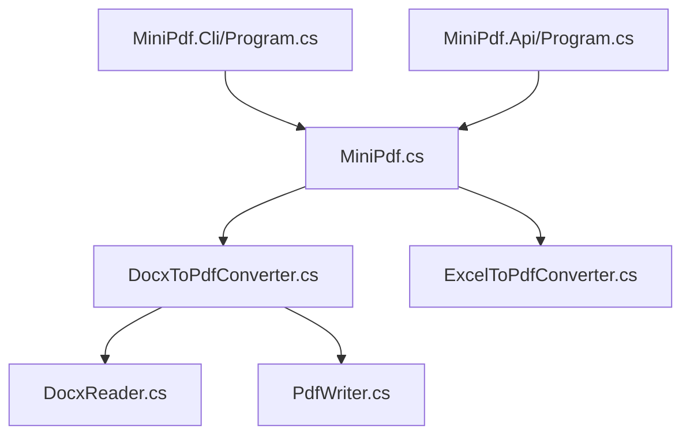

# mini-software/MiniPdf

> Convertit des fichiers Office (DOCX, XLSX, PPTX) en PDF sans Office ni LibreOffice, en six langages.

## Le problème
Générer un PDF depuis un document Office oblige souvent à embarquer LibreOffice ou Microsoft Office sur le serveur.

## Ce que ça fait vraiment
`MiniPdf.cs` choisit un convertisseur selon le format (DOCX, Excel, PPTX), lit le document avec son lecteur puis écrit le PDF avec `PdfWriter`. Il s'utilise en bibliothèque ou en ligne de commande ; la maturité varie : .NET, Rust et Node sont dits stables, Java et Go expérimentaux.

## Comment c'est branché


## Essayer
```bash
pip install minipdf   # non documenté : le README montre seulement l'import Python
dotnet tool install --global MiniPdf.Cli
minipdf report.docx -o report.pdf
```

## Coût et pièges
Gratuit. Le README annonce Apache 2.0 mais GitHub ne l'identifie pas : à vérifier. Le rendu des mises en page complexes peut différer d'Office. Le paquet Python ne couvre que DOCX.

## Ce que ce n'est pas
Pas une compatibilité complète avec Office : le README vise une conversion pratique, pas fidèle à l'identique.

## Alternatives
Aucune alternative nommée dans le README.

## Pour toi
À surveiller : pratique pour sortir des rapports PDF dans un pipeline sans LibreOffice, mais jeune (février 2026) et au rendu à tester sur tes documents.

