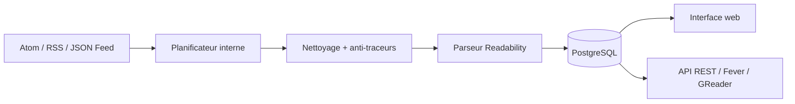

# miniflux/v2

> Minimalist feed reader in Go, single binary, backed by PostgreSQL.

## The problem
Hosted feed readers track your reading, impose their interface and shut down; self-hosted ones often drag along a heavy stack to maintain.

## What it actually does
Reads Atom 0.3/1.0, RSS 1.0/2.0 and JSON Feed 1.0/1.1, imports/exports OPML, handles categories, bookmarks, attachments and full-text search via Postgres. Removes tracking pixels and tracking parameters (`utm_*`, `fbclid`), blocks external JavaScript, applies a CSP and a Trusted Types Policy, and proxies media. Extracts the original article with a local Readability parser, with scraping and rewrite rules based on CSS selectors and regex filters. More than 25 integrations, REST API, Fever and Google Reader compatibility.

## How it is wired

## Trying it
No command is given in this README; it points to the installation instructions in the official documentation, with Debian/RPM packages, binaries and Docker images on Docker Hub, GHCR and Quay.io.

## Cost and gotchas
Free, Apache 2.0. **PostgreSQL is mandatory**: no other database is supported. Automatic HTTPS via Let's Encrypt, or bring your own certificates. Modern browsers only.

## What it is not
Not a smart aggregator: no recommendation, no summaries, no AI. Not infinitely customizable — the project claims to be "opinionated", with a section in the documentation dedicated to that choice. Driven essentially by a single author.

## Alternatives
No alternative repository is named in the README.

## For you
The clean foundation if you want to industrialize a watch process without handing your reading to a third-party service.
