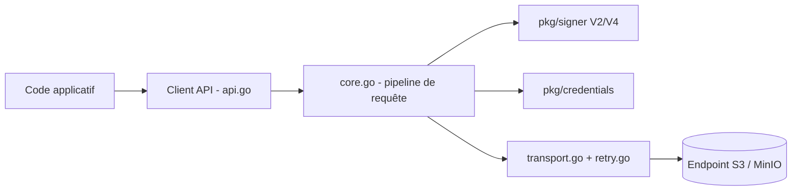

# minio/minio-go

> Go SDK for talking to any Amazon S3-compatible object storage, aimed at Go developers.

## The problem
Talking to S3 object storage by hand means signing every HTTP request, handling multipart uploads and S3-specific errors.

## What it actually does
The root package exposes bucket and object operations (put, get, stat, copy, remove, presigned, policies, lifecycle, encryption, replication). Each call builds a request, signs it (Signature V2 or V4), sends it through a transport with retries, then decodes the response. Credential providers (static, environment variables, files, STS) live in `pkg/credentials`. A few MinIO-specific extensions exist (notifications, RDMA).

## How it is wired


## Trying it
```bash
go get github.com/minio/minio-go/v7
go mod init example/FileUploader
go get github.com/minio/minio-go/v7/pkg/credentials
go run FileUploader.go
mc ls play/testbucket
```

## Cost and gotchas
Free, but you need an S3 endpoint (the public `play.min.io` server in the example is open to everyone: any data there is public). The access keys in the example are public, never reuse them.

## What it is not
It is not a MinIO server, only a client. It is not a command-line tool (the README relies on `mc` to verify). It only works in Go.

## Alternatives
No alternative named in the README; `mc` is cited only as a verification tool.

## For you
Worth watching: useful only if you write Go that reads or writes object storage, otherwise nothing to gain on the Python data side.
