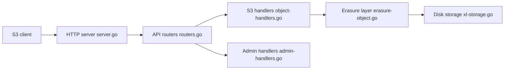

# minio/minio

> Self-hosted S3-compatible object storage server; community repository now archived.

## The problem
Having local or on-premise S3 storage for datasets and artifacts without depending on AWS.

## What it actually does
Go server exposing the S3 API: buckets, objects, erasure coding on local disks.
Built-in web console, IAM, bucket policies, lifecycle, replication, tiering, notifications, S3 Select, metrics.
Distributed as source only: no more up-to-date community binaries.
**Repository archived, no longer maintained**; the vendor points to AIStor Free / Enterprise.

## How it is wired


## Trying it
```bash
go install github.com/minio/minio@latest
minio server PATH
mc alias set local http://localhost:9000 minioadmin minioadmin
mc admin info local
```

## Cost and gotchas
Go ≥ 1.24 to build; default credentials `minioadmin:minioadmin` must be changed. AGPL-3.0: obligations to be validated for any use.

## What it is not
No longer a living project: expect no security fixes. The historical binaries are no longer updated. Production on a source build is "at your own risk".

## Alternatives
- AIStor Free / AIStor Enterprise: successors cited by the vendor (not named GitHub repositories).

## For you
Do not start new projects on it; plan the migration of MLOps stacks that use it.
