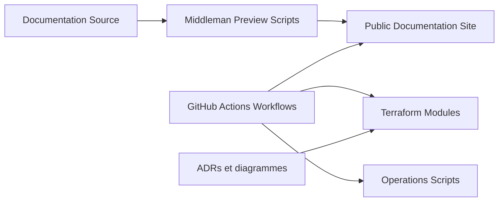

# ministryofjustice/analytical-platform

> Technical documentation and Terraform infrastructure of the UK Ministry of Justice's analytical platform.

## The problem
A ministry's analysts need a place to store, ingest and consume data, with documented infrastructure.

## What it actually does
The repository publishes the technical documentation, built with Middleman and published to GitHub Pages by GitHub Actions. It also contains the Terraform code for the AWS infrastructure (EKS, S3, Athena, IAM, Route53), operations scripts and ADRs. It points to the other `analytical-platform-*` repositories.

## How it is wired


## Trying it
```bash
make preview
bash scripts/docs/docker.sh check
```

## Cost and gotchas
The Terraform components require the ministry's AWS accounts, an `aws-sso` connection and a GitHub token federated via Octo STS. The infrastructure cannot be reproduced without this access. The platform does not yet accept new data products.

## What it is not
It is not an installable platform: it is the documentation and infrastructure of an internal service. The project describes itself as being in the research and design phase.

## Alternatives
No alternative named in the README.

## For you
Worth watching: the ADRs and the Terraform organization may inspire your own data platform, but nothing is reusable as is.
