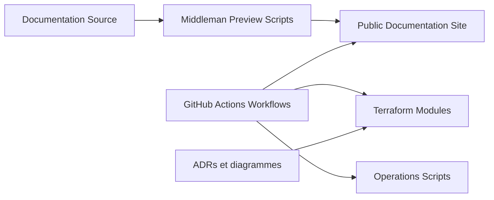

# ministryofjustice/analytical-platform

> Documentation technique et infrastructure Terraform de la plateforme analytique du ministère de la Justice britannique.

## Le problème
Les analystes d'un ministère ont besoin d'un lieu pour stocker, ingérer et consommer des données, avec une infrastructure documentée.

## Ce que ça fait vraiment
Le dépôt publie la documentation technique, construite avec Middleman et publiée sur GitHub Pages par GitHub Actions. Il contient aussi le code Terraform de l'infrastructure AWS (EKS, S3, Athena, IAM, Route53), des scripts d'exploitation et des ADR. Il renvoie aux autres dépôts `analytical-platform-*`.

## Comment c'est branché


## Essayer
```bash
make preview
bash scripts/docs/docker.sh check
```

## Coût et pièges
Les composants Terraform exigent des comptes AWS du ministère, une connexion `aws-sso` et un jeton GitHub fédéré via Octo STS. Impossible de reproduire l'infrastructure sans ces accès. La plateforme n'accepte pas encore de nouveaux produits de données.

## Ce que ce n'est pas
Ce n'est pas une plateforme installable : c'est la documentation et l'infrastructure d'un service interne. Le projet se dit en phase de recherche et de conception.

## Alternatives
Aucune alternative nommée dans le README.

## Pour toi
À surveiller : les ADR et l'organisation Terraform peuvent inspirer ta propre plateforme de données, mais rien n'est réutilisable tel quel.

